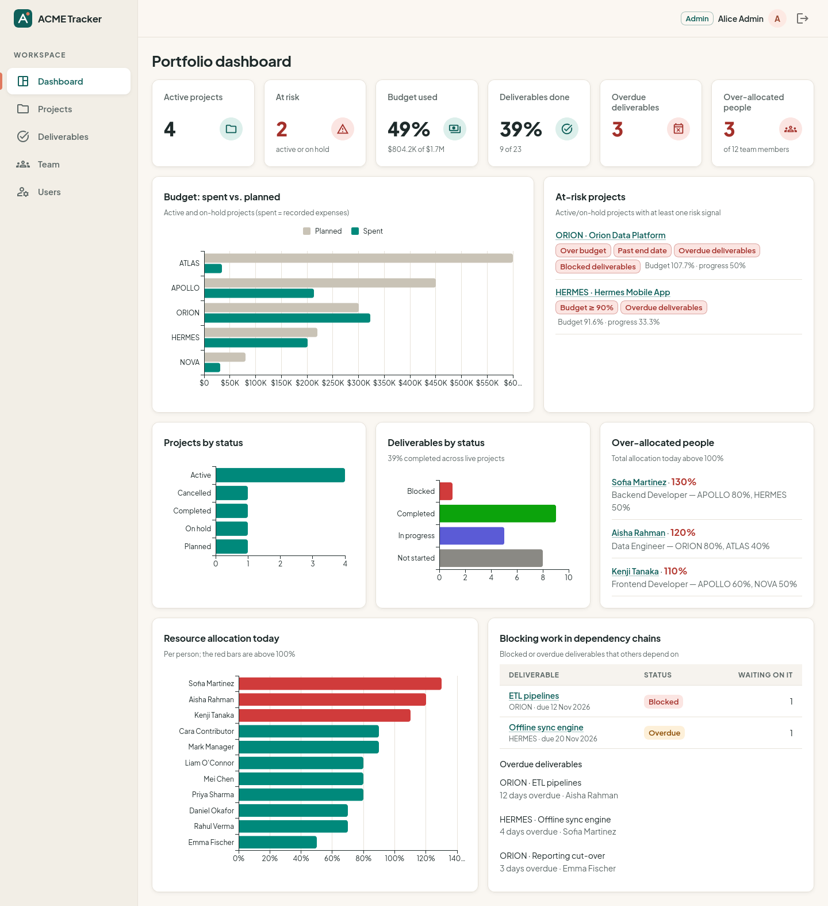
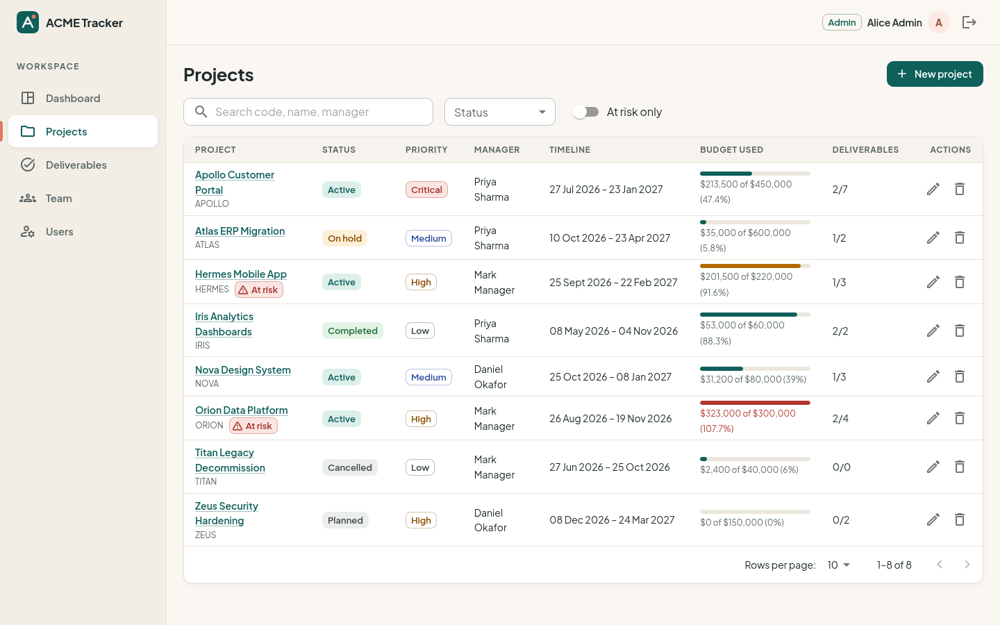
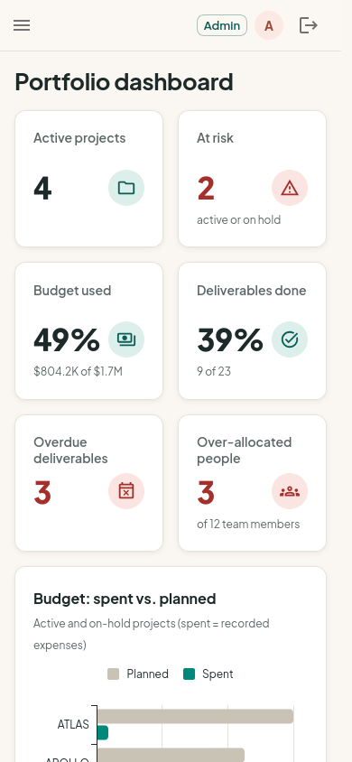
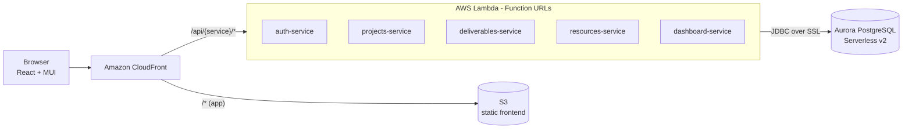

# ACME Project Tracker

ACME Inc. runs many projects at once with shared people and fixed budgets. Status lives in
spreadsheets, so nobody can quickly see which projects are slipping, who is overbooked or
how much money is left. ACME Project Tracker is a web application that keeps projects,
deliverables, dependencies, team allocations and expenses in one PostgreSQL database. It
answers those questions from the data, with role-based access so that each person sees and
changes only what their role allows. It runs on AWS Serverless: a React frontend served
by CloudFront, Java Lambda services, and Aurora PostgreSQL.

## Live demo

**<https://dbi1uqut4q6ch.cloudfront.net>**

The database scales to zero when idle, so the first request after a quiet period can take
15-20 seconds while Aurora resumes.

### Demo accounts

All demo accounts use the password `Demo@1234`.

| Email | Password | Role | What the role can do |
|---|---|---|---|
| `admin@acme.com` | `Demo@1234` | Admin | Everything, including managing users (change roles, activate or deactivate, delete) |
| `manager@acme.com` | `Demo@1234` | Manager | Read, create, update and delete all project data; no user management |
| `contributor@acme.com` | `Demo@1234` | Contributor | Read, create and update; cannot delete |
| `viewer@acme.com` | `Demo@1234` | Viewer | Read only |

Anyone can register on the Register page. New accounts are always Viewers, and an Admin
can upgrade them. The demo accounts are for demonstration only: change their passwords or
delete them before the system holds real data.

## Screenshots

<!-- Add the images to docs/screenshots/ and uncomment the lines below. -->
<!--  -->
<!--  -->
<!--  -->

| Screen | File |
|---|---|
| Dashboard | `docs/screenshots/dashboard.png` |
| Projects list | `docs/screenshots/projects.png` |
| Mobile layout | `docs/screenshots/mobile.png` |

## How the app answers the business questions

| # | Business question | Where to find it | How it is calculated |
|---|---|---|---|
| 1 | Current status of each active project | Dashboard ("Projects by status"), Projects list (status filter), Project detail | Each project has a status: `planning`, `active`, `on_hold`, `completed` or `cancelled`. Progress = completed deliverables ÷ all deliverables. |
| 2 | Projects at risk of missing deadlines | Dashboard ("At-risk projects"), Projects list (at-risk filter), Project detail (risk reasons) | An active or on-hold project is at risk if any of these is true: spend is over budget, spend is at least 90% of budget, the end date has passed, a deliverable is overdue, or a deliverable is blocked. Each at-risk project lists its reasons. These rules are defined once, in the `project_overview` SQL view. |
| 3 | Resource allocation across projects | Dashboard ("Resource allocation today"), Team page, Member page, Project detail (allocations) | Each allocation records a person, a project, a percentage (1-100) and a date range. A person's allocation today is the sum of their allocations whose date range includes today (`member_overview` view). |
| 4 | Key deliverables and their completion status | Deliverables page (status, project and overdue filters), Dashboard ("Deliverables by status") | A deliverable has one of four statuses: `not_started`, `in_progress`, `blocked` or `completed`. It counts as overdue if it is not completed and its due date has passed. |
| 5 | Over-allocated team members (> 100%) | Dashboard ("Over-allocated people"), Team page (over-allocated filter) | A person is over-allocated when their allocation today is above 100%. Saving an allocation that causes this still succeeds, but the API returns a warning with the person's peak allocation. |
| 6 | Dependency chain between deliverables | Deliverables page (dependency dialog), Dashboard ("Blocking work in dependency chains") | A recursive SQL query walks the chain in both directions: everything a deliverable waits on and everything waiting on it, plus the unfinished items blocking it. A new dependency is rejected with a 400 if it would create a cycle, points at the deliverable itself or links two projects. A deliverable cannot be completed while any prerequisite is open. |
| 7 | Budget consumed vs planned per project | Dashboard ("Budget: spent vs. planned"), Projects list, Project detail (expenses) | Consumed = the sum of the project's recorded expenses. The app also shows the remaining budget and the percentage used. Allocations are not costed. |

## Features

* **Authentication:**
  * Passwords are hashed with bcrypt.
  * Users sign in with a JWT access token that lasts 30 minutes and a refresh token that lasts 7 days. The frontend refreshes once automatically; when the session has expired it sends the user back to the login page.
  * Self-registration validates input on the client and the server (8-72 characters, at least one letter and one digit) and returns 409 for an email that is already registered.
* **Role-based access control**, enforced by the backend on every endpoint (403 otherwise).
  The UI hides actions a role cannot perform.

  | Role | Read | Create / update | Delete | Manage users |
  |---|---|---|---|---|
  | Admin | ✓ | ✓ | ✓ | ✓ |
  | Manager | ✓ | ✓ | ✓ | |
  | Contributor | ✓ | ✓ | | |
  | Viewer | ✓ | | | |

  Admins cannot demote, deactivate or delete themselves, and the last active Admin cannot be
  removed, so the system always keeps at least one Admin.
* **CRUD** for projects, expenses, deliverables, dependencies, team members, allocations and (Admin only) users. Create and edit forms are dialogs with inline field validation. The app shows a message after every save or error.
* **Search, filter, sort and paging** on every list. These are also available as API query parameters (`search`, filters, `sort`, `order`, `limit`, `offset`).
* **Dashboard** with portfolio metrics and charts (MUI X Charts).
* **Responsive design:** on small screens the sidebar collapses into a drawer and tables become cards (react-responsive). Every page has loading, empty and error states, and unknown routes show a 404 page.

## Tech stack

| Layer | Technology |
|---|---|
| Frontend | React 19, Material UI 7, MUI X Charts 8, React Router 7, react-responsive 10, Vite 7 |
| Backend | Java 21 on the AWS Lambda `java25` runtime, plain JDBC, Jackson, java-jwt, jBCrypt (no framework) |
| Database | PostgreSQL locally; Amazon Aurora PostgreSQL Serverless v2 (17.7, scales 0-4 ACU) on AWS |
| Hosting | AWS Lambda Function URLs, CloudFront, S3 |
| Infrastructure | Terraform; LocalStack for local AWS |
| Tests | JUnit 5, Mockito, JaCoCo; Jest 29 and Testing Library |

**Why Java instead of Python.** The workshop guide recommends Python but also supports Java
and Node.js, and provides a `backend/_examples/java-service` template. I chose Java because
it is the language I am strongest in, so I could spend the limited time on the domain
instead of the language. The cost: the Java path in the template needed several build and
packaging fixes (J1-J7 below), and I committed to switching to Python if it did not work
end to end within 1.5 hours. It worked within that time. To keep cold starts short I avoided
Spring: a cold start takes about 0.3 s at 1024 MB.

## Architecture



Locally, the same services run in LocalStack. A small Node proxy on port 3001 maps
`/api/<service>` to each Function URL, and the database is a local PostgreSQL.

### Services

| Service | Responsibility |
|---|---|
| `auth-service` | Registration, login, token refresh, current user, user administration (Admin), DB health check |
| `projects-service` | Projects and expenses; budget, progress and risk roll-ups |
| `deliverables-service` | Deliverables, dependencies, dependency chains and cycle checks |
| `resources-service` | Team members and allocations; over-allocation |
| `dashboard-service` | Read-only portfolio metrics and per-project health |

All five services build on **`backend/_common`**, which holds a parent POM and the
`common-lib` module. `common-lib` contains the HTTP router and JSON responses, JWT
issuing and verification, roles and permissions, the request validator, the
search/filter/sort/paging query builder, database access (one reused connection per Lambda
container, transactions), migrations, and the demo seed data. The services contain only
their own endpoints.

### Database

| Table | Contents |
|---|---|
| `users` | Login accounts: email, bcrypt hash, full name, role, active flag |
| `team_members` | People who can be allocated to projects (optionally linked to a user) |
| `projects` | Code, name, status, priority, dates, planned budget, manager |
| `expenses` | Costs recorded against a project (budget consumed) |
| `deliverables` | Work items per project: owner, status, due date |
| `deliverable_dependencies` | "Deliverable X depends on Y" edges within a project |
| `allocations` | Team member × project × percentage × date range |

Three SQL views hold the roll-ups, so every service and the dashboard use the same
definitions: `project_overview` (budget, progress, at-risk reasons), `deliverable_overview`
(overdue flag, dependency counts) and `member_overview` (allocation today, over-allocation).
Migrations live in `backend/_common/common-lib/src/main/resources/db/migration`. They run
automatically, under an advisory lock, on the first request to any service. The demo data is
loaded when the tables are empty.

## Project structure

```text
.
├── backend/
│   ├── _common/               parent POM + common-lib (shared code, migrations, seed data)
│   ├── auth-service/          one Maven module per Lambda (com.example.Handler)
│   ├── projects-service/
│   ├── deliverables-service/
│   ├── resources-service/
│   └── dashboard-service/
├── frontend/src/
│   ├── pages/                 one component per route
│   ├── components/            layout, dialogs, tables, charts helpers
│   ├── context/               auth session and notifications
│   ├── services/              API client and one module per backend service
│   └── utils/                 formatting and validation rules
├── infra/                     Terraform: Lambda, CloudFront, S3, Aurora
├── bin/                       setup, local development and deployment scripts
└── docs/                      workshop guide
```

## Run locally

### Prerequisites

Run `./bin/setup-environment.sh` once (see [bin/README.md](./bin/README.md)). It installs
Node.js, Docker, LocalStack, Terraform, the AWS CLI and a JDK, but not Maven. To install
Maven 3.9 without root access:

```sh
mkdir -p ~/.local/share ~/.local/bin
curl -fsSL https://archive.apache.org/dist/maven/maven-3/3.9.9/binaries/apache-maven-3.9.9-bin.tar.gz \
  | tar -xz -C ~/.local/share
ln -sf ~/.local/share/apache-maven-3.9.9/bin/mvn ~/.local/bin/mvn
export PATH="$HOME/.local/bin:$PATH"
export JAVA_HOME=/usr/lib/jvm/java-21-openjdk-amd64   # any JDK 21 or newer
mvn -version
```

PostgreSQL must accept connections from the LocalStack Lambda containers. `start-dev.sh`
sets this up with `sudo`: it sets `listen_addresses = '*'` and allows `172.16.0.0/12`. If
it cannot prompt for a password, run its PostgreSQL step in a normal terminal.

### Start

```sh
./bin/start-dev.sh
```

This command:

1. Starts PostgreSQL and LocalStack.
2. Builds the services and deploys them to LocalStack.
3. Writes `frontend/.env.local`.
4. Starts the API proxy on <http://localhost:3001> and the app on <http://localhost:3000>.

The first request creates the tables and loads the demo data.

## Deploy to AWS

```sh
export AWS_REGION=<your workshop region>
./bin/deploy-backend.sh aws
./bin/deploy-frontend.sh aws
```

`deploy-frontend.sh` builds the app, uploads it to S3 and prints the CloudFront URL, which
serves both the website and the API. Terraform generates the JWT signing secret
(`random_password.jwt_secret`) and passes it to every Lambda as `JWT_SECRET`. The secret is
never stored in the repository.

### Reset the demo data

To put an AWS environment back to exactly the demo data, invoke the auth Lambda directly
with your AWS credentials. This deletes **all** data, including every account created
since. It runs in one transaction, so a failure changes nothing. The reset cannot be
triggered through the website or the public API.

```sh
aws lambda invoke --function-name coding-workshop-auth-service-<participant-id> \
  --cli-binary-format raw-in-base64-out --payload '{"maintenance":"reset-demo-data"}' /dev/stdout
```

## Testing

```sh
# Backend: unit tests and integration tests against the local PostgreSQL (database acme_test).
# JaCoCo reports go to backend/*/target/site/jacoco; the build fails below 80% line coverage.
mvn -f backend/_common/pom.xml verify

# Frontend: lint, then Jest + Testing Library with coverage (report in frontend/coverage)
cd frontend
npm install
npm run lint
npm run test:coverage
```

The integration tests connect to `127.0.0.1:5432` as `postgres` / `postgres123` by default.
To use a different database, set `TEST_POSTGRES_HOST`, `TEST_POSTGRES_PORT`,
`TEST_POSTGRES_USER` and `TEST_POSTGRES_PASS`.

Results from a fresh run on 2026-11-24. All tests pass and `npm run lint` reports no problems.

| Suite | Tests | Line coverage | Branch coverage |
|---|---|---|---|
| `common-lib` (unit + integration) | 37 + 7 | 91.8% | 82.7% |
| `auth-service` | 1 + 22 | 93.0% | 83.8% |
| `projects-service` | 1 + 5 | 96.2% | 81.8% |
| `deliverables-service` | 1 + 5 | 95.7% | 80.6% |
| `resources-service` | 1 + 3 | 94.4% | 66.7% |
| `dashboard-service` | 1 + 2 | 94.9% | n/a (no branches) |
| **Backend total** | **86** (42 unit, 44 integration) | | |
| **Frontend** (17 Jest suites) | **90** | 84.8% | 74.2% |

Backend coverage is JaCoCo, merged across unit and integration tests. The integration tests
run each service's handlers against a real PostgreSQL database and cover:

* role checks on every service;
* the last-admin and self-demotion guards;
* registration rules (409 for a duplicate email, the `role` field ignored);
* cycle rejection for dependencies;
* the over-allocation warning;
* the demo-data reset.

## API overview

Every path is served under `/api/<service>`, for example `POST /api/auth-service/login`.
Every endpoint except `GET /health`, `GET /health/db`, `POST /login`, `POST /register` and
`POST /refresh` (which needs a valid refresh token) requires a bearer token.

| Service | Main endpoints |
|---|---|
| auth-service | `POST /register`, `POST /login`, `POST /refresh`, `GET /me`, `GET /health/db`; Admin: `GET/POST /users`, `GET/PUT/DELETE /users/{id}` |
| projects-service | `GET/POST /projects`, `GET/PUT/DELETE /projects/{id}`, `GET/POST /projects/{id}/expenses`, `PUT/DELETE /expenses/{id}` |
| deliverables-service | `GET/POST /deliverables`, `GET/PUT/DELETE /deliverables/{id}`, `GET /deliverables/{id}/chain`, `POST /deliverables/{id}/dependencies`, `DELETE /deliverables/{id}/dependencies/{dependsOnId}`, `GET /deliverables/graph?project_id=` |
| resources-service | `GET/POST /members`, `GET/PUT/DELETE /members/{id}`, `GET/POST /allocations`, `PUT/DELETE /allocations/{id}` |
| dashboard-service | `GET /summary`, `GET /projects/{id}/health` |

**Conventions:**

* List endpoints return `{ items, total, limit, offset }`. `limit` is between 1 and 200.
* Status codes: 200, 201, 204, 400, 401, 403, 404, 409 (email already registered) and 500.
* Every error has the same shape:
  `{"error": {"code": "VALIDATION_FAILED", "message": "...", "details": {"field": "problem"}}}`.
* A 500 response never includes internal details or stack traces.

## Template issues found and fixed

| Issue | Fix |
|---|---|
| J1: Maven missing | `setup-environment.sh` does not install Maven; this README documents a user-space install of Maven 3.9.9. |
| J2: JDK mismatch | The example POM compiles with `release 25`, but the VDI has JDK 21. The code compiles with `release 21` and runs unchanged on the `java25` Lambda runtime. |
| J3: Build cleanup | The cleanup step's `find ./target ... -delete` exited 1 because it tried to delete `target/` itself. Fixed with `-mindepth 1`. |
| J4: Rebuild trigger | The trigger hashed file sizes only and ignored shared code. It now hashes the contents of the service and of `backend/_common`, plus the build command. |
| J5: JDBC driver | The shaded jar dropped the driver's `META-INF/services` registration. Fixed with `ServicesResourceTransformer`, and `Db` loads `org.postgresql.Driver` directly. |
| J6: Memory and cold starts | Java Lambdas get 1024 MB, and `JAVA_TOOL_OPTIONS` stops the JIT at tier 1 for faster cold starts. |
| J7: Jar location | A jar at the root of the Lambda zip caused `ClassNotFoundException`, because the runtime only loads `/var/task/lib`. The build now puts the jar in `target/lib/`. |
| CloudFront 404s | CloudFront rewrote every 404, including API 404s, to `index.html`. A CloudFront Function now serves `index.html` only for app routes, and API errors reach the client as JSON. |
| Proxy auth header | The local proxy dropped `Authorization` and other request headers; it now forwards them. It also trims the Function URL's trailing slash (`//login` returned 502). |
| Aurora wake-up timeout | The first request after Aurora paused at 0 ACU failed after 5 s (pgjdbc `sslResponseTimeout`). The timeout and `loginTimeout` are now 30 s, with one connection retry. |
| `.bashrc` exports | `~/.bashrc` sets `AWS_REGION` without `export`, so scripts fell back to `us-east-1` and `terraform init` failed. Workaround: `export AWS_REGION=...` before deploying. The VDI's `.bashrc` is not part of this repo, so it was not changed. |
| `JAVA_HOME` in setup script | `setup-environment.sh` wrote `JAVA_HOME` with an unexpanded `$JAVA_VERSION`; fixed. |
| Frontend deploy state | `deploy-frontend.sh` read LocalStack's Terraform state after a local run; it now runs `terraform init` for its own environment first. |
| Shared code build | Terraform builds and installs `backend/_common` before any service (`null_resource.java_common_build`). |
| JWT secret | The template had no signing secret; Terraform now generates one and passes it to every Lambda as `JWT_SECRET`. |
| ESLint config | The template's ESLint config imported plugins that were not installed; they are now installed, and test files get Jest globals. |

## Design decisions and trade-offs

* **Plain Java instead of Spring.** Cold starts stay around 0.3 s with a small shaded jar. The price is a small hand-written router and validator in `common-lib`.
* **One reused JDBC connection per Lambda container** instead of a pool. A Lambda container handles one request at a time. The connection is checked and reopened when needed.
* **Migrations and seeding run on the first request** rather than as a deploy step, so a new environment works without manual database setup. An advisory lock keeps concurrent cold starts safe.
* **Roll-ups live in SQL views**, so the "at risk", "over-allocated" and "budget used" definitions exist once.
* **Budget consumed = sum of expenses.** Allocations are not costed, because no rates were in scope.
* **Over-allocation is allowed but reported.** Finding over-allocated people is one of the business questions, so saving one succeeds and returns a warning.
* **Dependencies stay within one project.** Cycles are rejected, and a deliverable cannot be completed while its prerequisites are open.
* **Least privilege for sign-up:** anyone can register, but only as a Viewer.
* **Tokens in `localStorage`** keep the frontend simple; the access token is short-lived.

### Known gaps and future improvements

* **Logout and tokens:** logout only clears the client's tokens, and there is no server-side refresh-token revocation. HttpOnly-cookie sessions with revocation would be stronger against XSS and stolen tokens.
* **Account self-service:** there is no email verification, password reset or self-service password change.
* **Allocation costs:** allocations have no cost rates, so people's time does not count toward budget consumed.
* **Dependency graph:** the dependency graph endpoint (`/deliverables/graph`) exists, but the UI shows chains as lists, not a visual graph.
* **CI:** the template's GitHub Actions only run security checks for Python, React and Terraform. No workflow runs the Java build or the test suites.
* **Integration tests:** they need a local PostgreSQL, and there are no browser end-to-end tests.
* **Audit history:** there is no record of who changed what.
* **Aurora resume:** after an idle period the first request waits 15-20 s for Aurora to resume. A minimum capacity above 0 ACU would remove the wait, at extra cost.

## Author

[Your full name], GitHub: <https://github.com/Ridhi-215>

Built for the Citi Technology Coding Workshop, November 2026.
